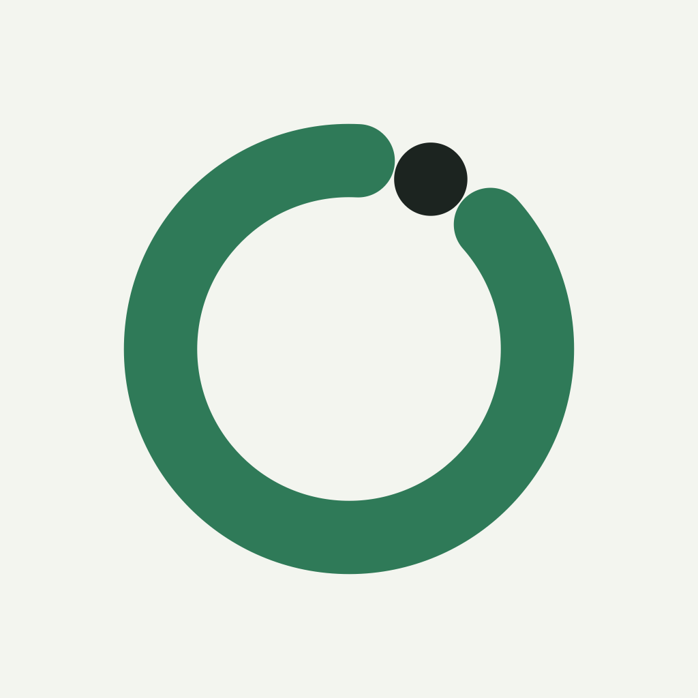
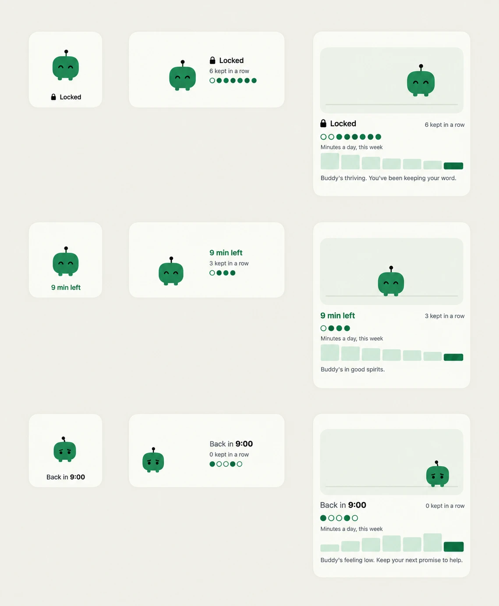

# Accountable

**An iPhone app that holds you to the social media limits you set for yourself.**

I watched social media take over my life and my friends' lives. "Five minutes" turned into an hour, and Screen Time limits were one tap from being ignored. I didn't want another app that lectures you or blocks everything. I wanted one that makes you decide how long you're going to scroll before you start, and then holds you to it. So I built Accountable.

## How it works

Pick the apps that eat your time. From then on they're locked by default.

When you open one, the lock screen asks how long you want: 5 minutes, 15, or your own number. That's one timer shared by all your apps, and only time spent in them counts. When it runs out, they lock again. That's your promise.

After each timer, whether it runs out or you stop early, you take a break. The first one is 5 minutes, and each one after that on the same day gets longer (10, 30, then 60). You can still unlock during a break, but it counts as a broken promise.

**Buddy** is a small green robot whose mood follows your promises. Keep them and he hops around happily. Break them and he shrinks and droops. Stopping on time never hurts him, and only kept promises cheer him back up.

There's more:

- **Your time.** Shows how many years of your life your current habit adds up to, and how many you'd win back by cutting down. It's based on CDC life expectancy tables.
- **Unwind.** Breathing exercises, a grounding exercise and better ideas for when you feel the pull.
- **Progress.** Kept promises in a row, your recent promises and minutes per day. A bad day doesn't erase your progress.
- **Widgets.** Buddy hops and blinks on your Home Screen.

## The research behind it

- Cutting social media to about 30 minutes a day reduced loneliness and depression within 3 weeks. *(Hunt et al., 2018)*
- In a large randomized experiment, a 4-week Facebook break freed up about an hour a day and improved well-being. *(Allcott et al., 2020)*
- Deciding in advance how you'll act makes you much more likely to follow through. *(Gollwitzer & Sheeran, 2006)*
- Five minutes a day of cyclic sighing, the first exercise in Unwind, lifted mood more than mindfulness meditation. *(Balban et al., 2023)*

## Privacy

Everything stays on your phone. There are no accounts, servers or analytics. Apple's Screen Time never tells the app which apps you picked or what you do in them.

The app has a hidden study mode for a separate University of Florida study. It logs anything only for participants who agree to it, and the log stays on their phone.

## Try it

**Simulator demo.** Clone the repo, open `Accountable.xcodeproj` in Xcode 26.3 or later and run it on an iPhone Simulator. Screen Time doesn't work in the Simulator, so it runs a demo with pretend apps and a sped-up clock.

**On an iPhone.** Locking apps needs a real iPhone on iOS 17 or later (26.4+ for the lock screen's time menu) and a paid Apple Developer account. Set your own team and bundle IDs, then follow [docs/TESTING.md](docs/TESTING.md).

The app is in testing now. TestFlight and the App Store come next.

Built with Swift and SwiftUI using FamilyControls, ManagedSettings, DeviceActivity and WidgetKit. It uses no third-party packages.

## Author

William Evans, University of Florida
